<a href="https://www.julienklaer.dev/">
  
</a>

hi, i'm julien. sre / cloud architect from metz, france, currently working in luxembourg.\
i write about code, music and nature over at [julienklaer.dev](https://www.julienklaer.dev/).

### \# latest

- `2026-05-07` **[Build a TUI for my Streamdeck (1/n)](https://www.julienklaer.dev/posts/tui-for-elgato-streamdeck-part-1/)**\
  <sub>and oh boy, what was I thinking.</sub>

<sub>→ [all posts](https://www.julienklaer.dev/posts/) · [rss](https://www.julienklaer.dev/rss.xml)</sub>

### \# projects

- **[maddock](https://github.com/MadJlzz/maddock)** · Configure fleets of VMs using recipes! · `go`
- **[madlab](https://github.com/MadJlzz/madlab)** · Orchestrate IaC tools
- **[terraform-provider-oneprovider](https://github.com/MadJlzz/terraform-provider-oneprovider)** · Terraform OneProvider provider · `go` · ★ 4
- **[provider-oneprovider](https://github.com/MadJlzz/provider-oneprovider)** · Crossplane provider for OneProvider · `go`
- **[ansible-runner-operator](https://github.com/MadJlzz/ansible-runner-operator)** · Lightweight operator that reconciles Ansible playbooks · `go`
- **[dotfiles](https://github.com/MadJlzz/dotfiles)** · An Ansible playbook that automates my laptops configuration · `shell` · ★ 1

### \# stack

```console
reader@madlab:~$ cat ./stack.txt
golang · python · terraform · ansible · k8s · otel · gcp · azure · aws
```

### \# elsewhere

[blog](https://www.julienklaer.dev/) · [rss](https://www.julienklaer.dev/rss.xml) · [twitch](https://twitch.tv/MadJlzz) · [linkedin](https://www.linkedin.com/in/klaer-julien/)

---

<sub>© 2026 MadJlzz</sub>
